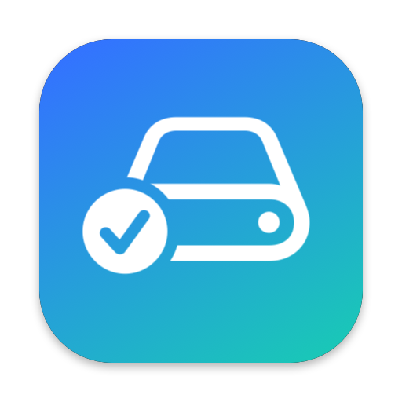
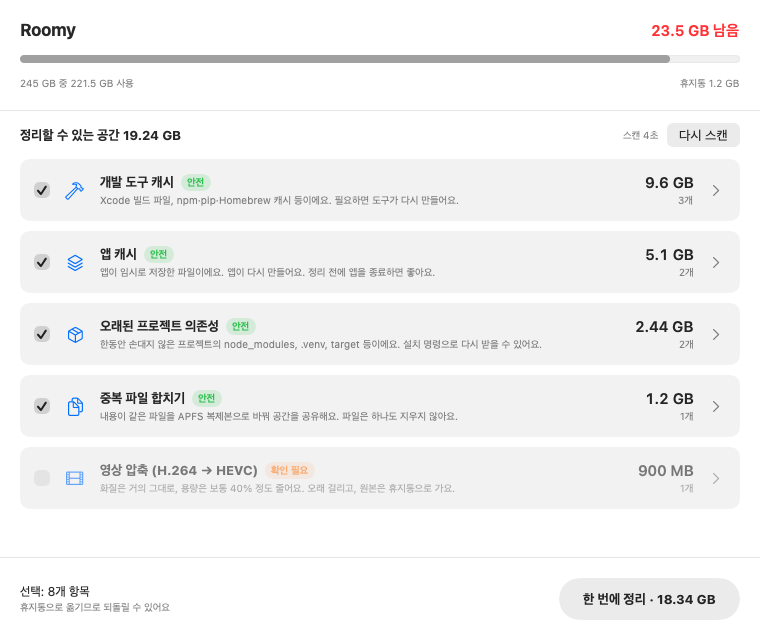
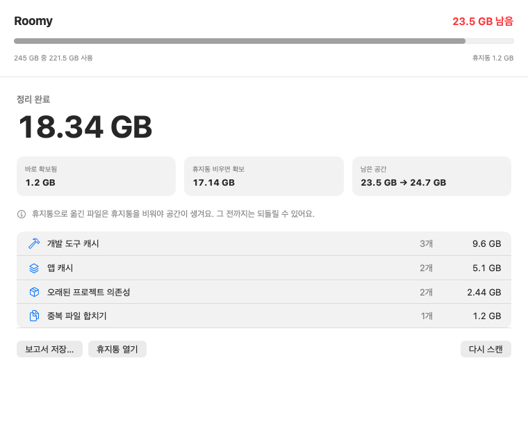

<p align="center"></p>

# Roomy

**One button to find and reclaim disk space on a small-SSD Mac.**
Built for developers and video creators on 256 GB machines.

Roomy is a native SwiftUI app (under 1 MB). Press **Scan**, review what it found,
press **Clean all**, and get a report. Scanning never changes anything, and cleaning
moves items to the Trash, so you can put anything back.

[한국어 안내는 아래에 있어요](#한국어)

<p align="center">
  
  
</p>

## What it finds

| Category | Default | What happens |
|---|---|---|
| Developer caches: Xcode DerivedData and DeviceSupport, npm, pip, uv, Poetry, Homebrew, CocoaPods, Go, Gradle, Cargo | on | Moved to Trash; the tools rebuild them |
| App caches in `~/Library/Caches` (≥ 50 MB each) | on | Moved to Trash; apps recreate them |
| Stale project dependencies: `node_modules`, `.venv`, `venv`, Rust `target`, SwiftPM `.build`, `Pods` in projects untouched for 30+ days | on | Moved to Trash; reinstall with the project's install command |
| Unavailable simulators | on | Deleted with `simctl delete` |
| Duplicate files (≥ 10 MB) | on | **Nothing is deleted.** Copies become APFS clones that share the original's blocks |
| Old installers (`.dmg`, `.pkg`, `.iso`, `.xip`) | off | Moved to Trash |
| Large files (≥ 1 GB) unopened for 90+ days | off | Moved to Trash |
| H.264 videos (≥ 300 MB) | off | Re-encoded to HEVC with the hardware encoder; original goes to Trash |

## Safety

- **Scan is read-only.**
- **Trash, not delete.** The only permanent deletion is simulators that can no longer run.
- **A guard checks every path.** Cleaning refuses anything outside your home folder, and anything that is or contains a protected folder (`~/Library`, `~/Documents`, `~/Downloads`, …).
- **Duplicates are re-verified.** Both files are hashed again just before cloning, and a file that changed since the scan is skipped. The clone keeps the copy's own name, permissions and dates.
- **A video is replaced only if it gets at least 10% smaller.**
- **Linked folders are left alone.** Before scanning and again before cleaning, Roomy indexes every symlink in your home folder (and on external drives your home links to). Anything another path still points into is flagged and refused. Example: an app moved model files into `~/Library/Caches` and linked them back from its model store.
- **Big app caches start unticked.** A "cache" over 1 GB may hold real data, so you opt in after a look.
- **Recent projects are never touched.** "Stale" is judged from lockfiles, manifests and `.git/index`.

## Build and run

Requires macOS 15+ and Xcode 16+ (Swift 6).

```bash
git clone https://github.com/Lvstw1205/Roomy.git && cd Roomy
scripts/build-app.sh          # → dist/Roomy.app
open dist/Roomy.app
```

During development, use `swift run Roomy`.

The app is ad-hoc signed. If you download a build instead of compiling it, right-click → Open the first time.
macOS will ask for access to Desktop, Documents and Downloads the first time Roomy scans them.

### CLI (read-only)

```bash
swift run roomy-cli scan
swift run roomy-cli scan --only devCaches,appCaches
```

## Project layout

```
Sources/RoomyCore   scanning rules, cleaner, safety guard, report (no UI, fully tested)
Sources/Roomy       SwiftUI app
Sources/roomy-cli   read-only command-line scanner
Tests               tests run against a throwaway home folder and a fake Trash
```

To add a category: add a case to `CategoryID` (`Models.swift`), return findings from `Rules.findings` (`Scanner.swift`), and add a test.

```bash
swift test
```

## Roadmap

- APFS transparent compression for rarely used apps and documents
- Move cold files to a NAS or external drive, keeping an index
- Plain-language explanations ("what is this 18 GB folder?")
- Settings for thresholds and excluded folders
- Signed and notarized releases

## Prior art

Roomy's categories and its preview-then-confirm flow follow established open-source cleaners: [Mole](https://github.com/tw93/Mole), [npkill](https://github.com/voidcosmos/npkill) and Free my Mac. Roomy contains no code from them.

## License

MIT

---

## 한국어

**256GB 맥 공간을 버튼 하나로 정리하는 앱이에요.** 개발자와 영상 작업자를 위해 만들었어요.

1. **스캔**을 누르면 개발 캐시, 앱 캐시, 오래된 `node_modules`, 중복 파일 등을 찾아요. 이 단계에서는 아무것도 바꾸지 않아요.
2. 목록을 확인하고 **한 번에 정리**를 누르면 선택한 항목을 휴지통으로 옮겨요.
3. **보고서**에서 확보한 용량을 확인하고 Markdown으로 저장할 수 있어요.

- 다른 곳에서 링크로 쓰고 있는 폴더는 정리하지 않아요. 1GB가 넘는 앱 캐시는 선택을 빼고 이유를 보여줘요.
- "안전" 항목은 미리 선택돼 있어요. "확인 필요" 항목(설치 파일, 큰 파일, 영상 압축)은 직접 선택해야 해요.
- 중복 파일은 지우지 않고 APFS 복제본으로 합쳐서, 파일은 그대로 두고 공간만 아껴요.
- 휴지통으로 옮긴 항목은 **휴지통을 비워야** 실제 공간이 생겨요.

```bash
scripts/build-app.sh && open dist/Roomy.app
```
